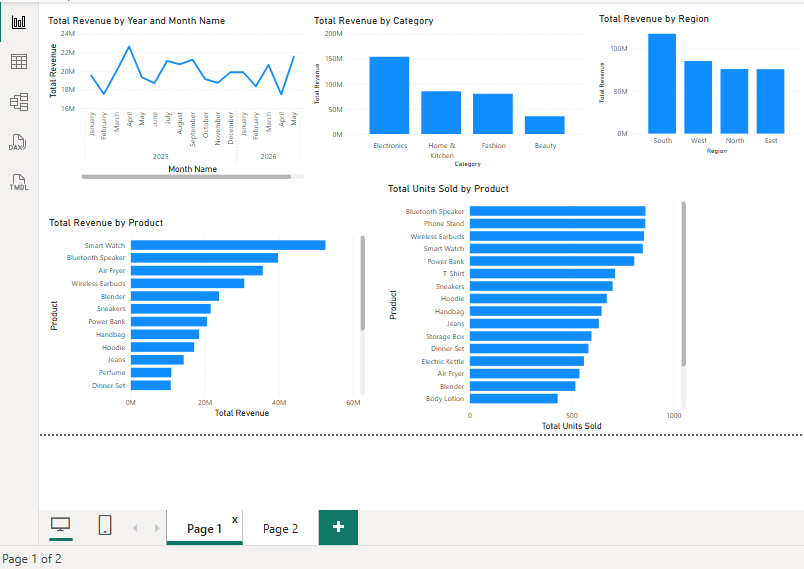
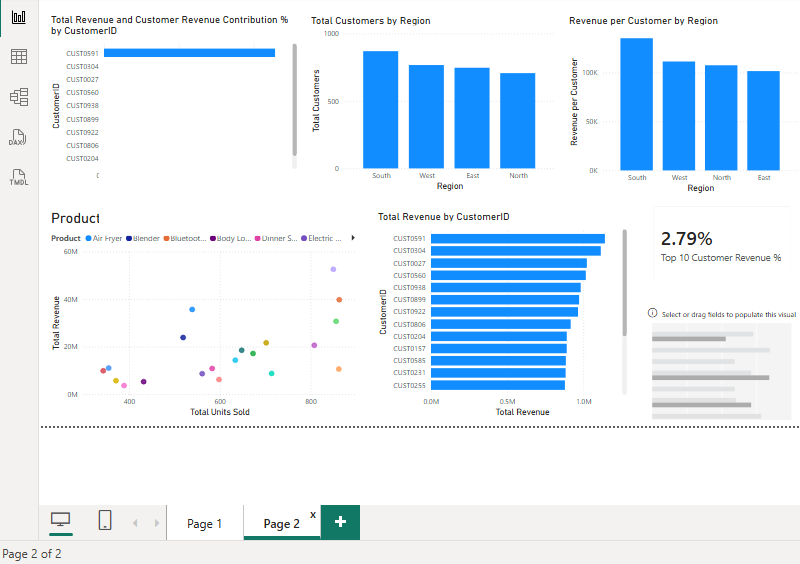

# E-commerce Sales & Customer Analytics

## Project Overview
This project analyzes e-commerce sales performance, customer purchasing behavior, product performance, and regional revenue using Power BI.

The goal is to turn sales data into actionable business insights that can help decision-makers understand revenue trends, identify top-performing products, and evaluate customer contributions.

## Business Questions
- How does revenue change over time?
- Which product categories and products generate the most revenue?
- Which regions contribute the most to total revenue?
- How do customer counts and average revenue per customer vary by region?
- Which customers contribute the most revenue?
- How concentrated is revenue among the top 10 customers?

## Tools Used
- Microsoft Power BI
- DAX
- Data modeling
- Data visualization
- Business intelligence and data storytelling

## Dashboard Highlights
The Power BI dashboard includes:
- Revenue trends by year and month
- Revenue by product category
- Revenue by region
- Revenue and units sold by product
- Customer counts by region
- Revenue per customer by region
- Customer-level revenue comparisons
- Top 10 customer revenue contribution KPI

## Key Skills Demonstrated
- Building interactive Power BI reports
- Designing KPI measures
- Creating analytical visualizations
- Comparing regional and product performance
- Analyzing customer revenue patterns
- Presenting data for business decision-making

## Project Files
The repository currently includes the project case study PDF. Dashboard screenshots and other appropriate portfolio materials may be added as the repository is completed.

## Dashboard Screenshots

### Executive Sales Overview

### Customer Analysis

## Data Privacy
Only appropriate portfolio materials should be shared publicly. Raw datasets containing personal or confidential customer information should not be uploaded without confirming that publication is authorized.

## Author
Data Analyst | Power BI | Excel | SQL | Python
